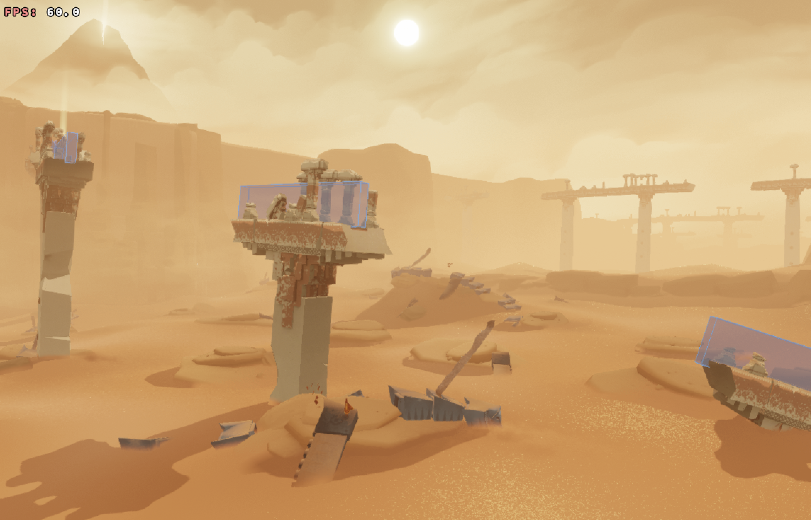
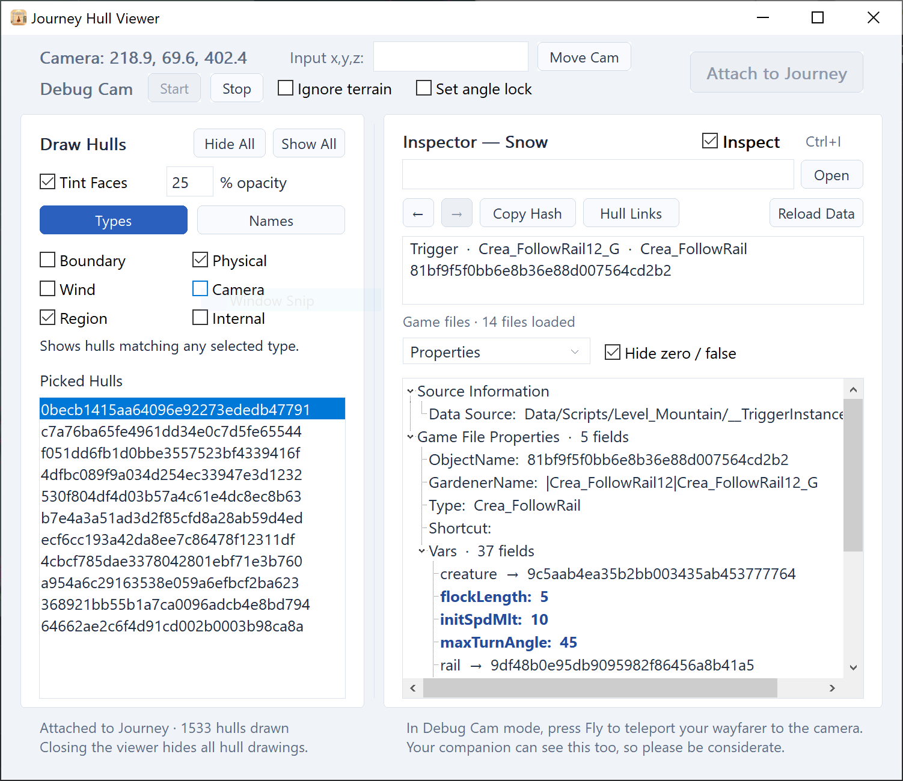

# Journey Hull Viewer

A standalone Windows tool for exploring Journey's hulls and the level objects
connected to them. See collision boundaries, camera volumes, wind hulls and
trigger regions in the game, then inspect their properties and references.

**Version 2.0.0**

*Highlighted hulls in Broken Bridge where footsteps produce a metallic sound.*

## Quick start

1. Keep `JourneyHullViewer.exe` and `journey_hull_viewer.dll` together in a folder
   of your choice. It does not have to be Journey's installation folder.
2. Start Journey and load a level.
3. Double-click `JourneyHullViewer.exe` to open the viewer, then click
   **Attach to Journey**.
4. Check a hull type, such as **Region**, or click **Show All**. Hull drawing
   starts hidden, with all types unchecked.
5. Enable **Inspect** with **Ctrl+I**, then click a hull face in the game.
   Select a result in **Picked Hulls** to highlight it and view its properties.
6. Use **Hide All**, or close the viewer, to hide the drawings.

After attachment, the viewer finds the running game's installation folder and
reads its `Data/Scripts` files automatically. Keep the game's original `Data`
folder intact.

While **Inspect** is enabled, the mouse is used for hull selection rather than
normal game controls. Press **Ctrl+I** again to restore normal mouse controls.
Keyboard controls remain available.

## What's included

- Hull outlines filtered by type or by up to 64 exact hull hashes.
- Transparent hull face highlighting with adjustable opacity.
- In-game picking and a persistent highlight while following object links.
- An inspector for properties, formatted data, incoming/outgoing references,
  and paths between triggers, clumps and hulls.
- Drawing all hull members of a clump, including nested clumps.
- Debug Cam controls, a camera-position display, and movement to entered coordinates.
- Selectable text, copyable hashes and coordinates, and Back/Forward navigation.

*Journey Hull Viewer interface.*

## Learn the controls

See the [User Guide](docs/USER_GUIDE.md) for drawing, picking, tracing references,
camera controls and troubleshooting. The [Changelog](CHANGELOG.md) summarizes
what changed since 1.0.0.

## Before using Debug Cam

Hull drawings and highlights are visible only to you, not your companion.
Drawing and inspecting hulls do not change collisions or the behavior of
triggers and other game objects.

In Debug Cam mode, press Fly to teleport your wayfarer to the camera.
Your companion can see this too, so please be considerate.

Closing the viewer hides the drawings, but does **not** reset debug-camera or
camera-collision settings. Use **Stop** and restore any camera options before
closing if you want normal camera behavior.

## Compatibility and limits

- Requires the Windows x64 version of Journey. Compatibility checks run before
  attachment; support for every game build or graphics compatibility layer is
  not guaranteed.
- Only one viewer can control a game process at a time. Mods that alter the
  same game functions may conflict; do not run another hull renderer alongside it.
- Showing many hulls can affect performance. Use type filters or selected hashes
  to reduce the amount drawn.
- Inspector properties and links come from level files. They do not prove that
  a trigger is currently active or will run. Picking also captures a hull's
  runtime state, which can change after the pick.

## Files and privacy

The viewer reads level data into memory and does not create extracted scripts,
lookup caches, logs or automatic crash reports. It does not modify game files
on disk. It loads a rendering DLL into the running game; drawing and camera
controls therefore change the running process, not the installed files.

Compressed level tables are parsed as data, never executed as scripts.
No game data is included in the distribution.

## Source and acknowledgements

See [Building and Testing](docs/BUILDING.md) for source-build instructions and
[Third-party Code](THIRD_PARTY.md) for dependency notices.

This is an unofficial tool, not affiliated with or endorsed by Journey's
developers or publisher. Journey artwork and game content belong to their
respective owners.
